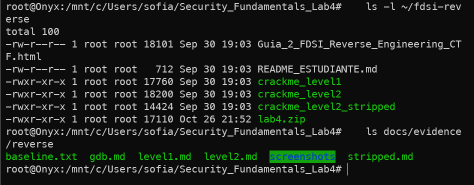
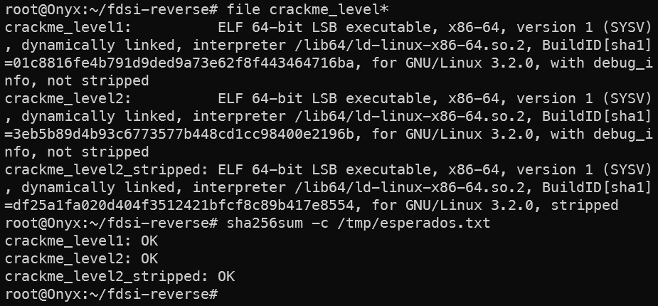
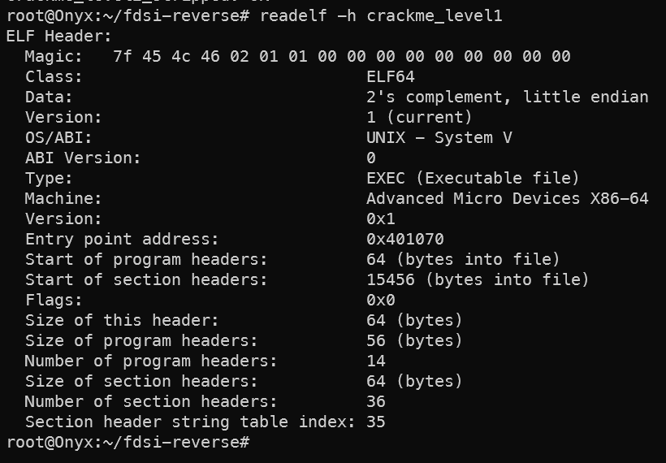
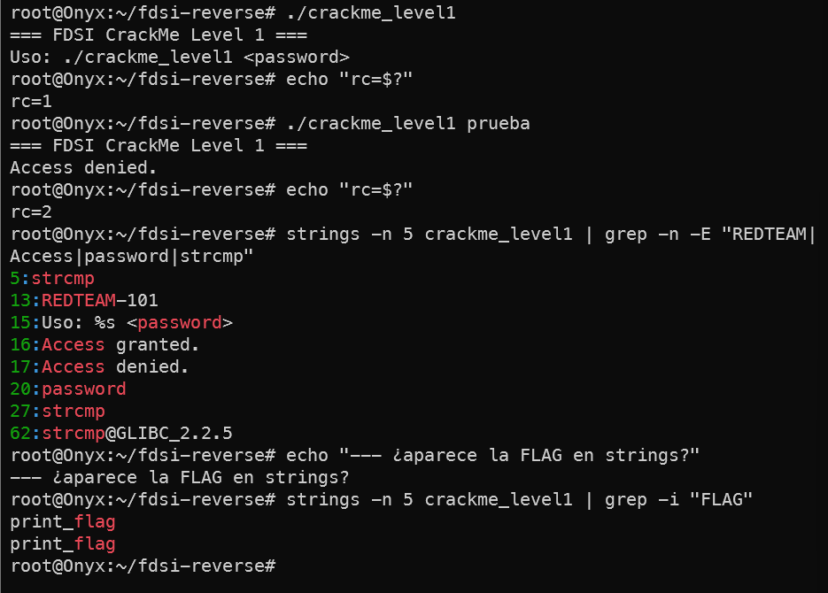
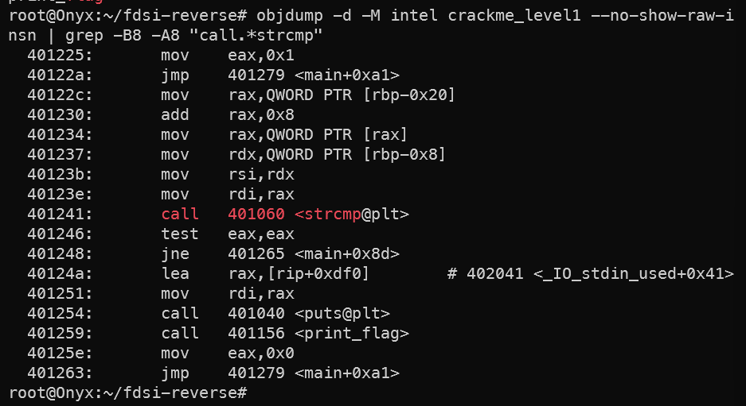
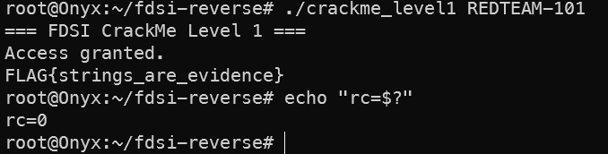

# Security Fundamentals — Lab 4: Reverse Engineering CTF

## Autoras: 

- María Belén Quintero Aldana

- Ángela Sofía Gómez Valencia 

Laboratorio de ingeniería inversa sobre *crackmes* académicos (ELF Linux x86-64) de la Guía 2 de FDSI.
El trabajo se hace sobre binarios compilados, sin acceso al código fuente, usando `file`, `sha256sum`,
`strings`, `readelf`, `objdump`, Ghidra y GDB.

- Entorno: Ubuntu sobre WSL (Windows).
- Rama de trabajo: `develop`.
- Los binarios **no** se versionan. Se verifican con los hashes de `docs/evidence/reverse/baseline.txt`.

## Estado del laboratorio

| Punto | Descripción | Estado |
|---|---|---|
| 0 | Preparación del entorno | Hecho |
| 1 | Baseline forense |  Hecho |
| 2 | Nivel 1: Strings are evidence |  Hecho |
| 3 | Nivel 2: Ghidra |  Pendiente |
| 4 | Confirmación dinámica con GDB |  Pendiente |
| 5 | Boss Level: binario stripped |  Pendiente |
| 6 | Evidencia final, preguntas de análisis y tag `lab-reverse-v1` |  Pendiente |

## Punto 0 · Preparación

Se instalaron las herramientas (`binutils`, `gdb`, `file`, `unzip`), se descomprimieron los tres binarios en
una carpeta de trabajo fuera del repositorio (`~/fdsi-reverse`) y se les dieron permisos de ejecución.
El repositorio se trabaja desde la rama `develop`, con la evidencia en `docs/evidence/reverse/`.



## Punto 1 · Baseline forense

Se ejecutaron `file`, `sha256sum` y `readelf -h` sobre los tres binarios y se guardó la salida en
[`baseline.txt`](docs/evidence/reverse/baseline.txt).

- Los tres hashes SHA-256 coinciden con los del material original (`sha256sum -c`: `OK`).
- Formato: ELF de 64 bits, little endian, arquitectura x86-64, ejecutable sin PIE (entry point `0x401070`).
- Linking dinámico contra libc.
- `crackme_level1` y `crackme_level2` conservan símbolos; `crackme_level2_stripped` no.
- El hash garantiza que todo el equipo analiza exactamente el mismo binario.





## Punto 2 · Nivel 1: Strings are evidence

Detalle completo en [`level1.md`](docs/evidence/reverse/level1.md).

1. **Observación:** sin argumento muestra el uso (código de retorno 1); con una clave incorrecta, `Access denied.` (código 2).
2. **Hipótesis:** el programa compara el argumento con una contraseña fija embebida en el binario.
3. **Evidencia con `strings`:** aparece `REDTEAM-101` junto a `strcmp`, `Access granted.` y `Access denied.`.
   La FLAG no aparece en texto plano; solo el nombre de la función `print_flag`.
4. **Evidencia con `objdump`:** `main` llama a `strcmp@plt` con `argv[1]`; si el resultado es 0 (`test eax,eax` / `jne`), llama a `print_flag`.
5. **Resultado:** `./crackme_level1 REDTEAM-101` → `Access granted.` → `FLAG{strings_are_evidence}`.

Lección de desarrollo seguro: un secreto compilado como literal queda en `.rodata` y cualquiera lo recupera con `strings`.







## Cómo retomar el laboratorio (para quien continúe)

1. Obtener los binarios del material de la guía (no están en el repo) y verificar su integridad:
   ```bash
   sha256sum -c hashes.txt   # usar los hashes de docs/evidence/reverse/baseline.txt
   ```
2. Continuar en la rama `develop`.
3. Pendiente: Nivel 2 con Ghidra (capturas con renombres), confirmación con GDB, Boss Level sobre el binario stripped,
   respuestas en `reverse-analysis.md` y tag `lab-reverse-v1`.
4. Los archivos `level2.md`, `gdb.md` y `stripped.md` y el código de `src/` son borradores iniciales y deben
   revisarse y validarse con el análisis propio en Ghidra y GDB.

## Estructura del repositorio

```
docs/
└── evidence/
    └── reverse/
        ├── baseline.txt
        ├── level1.md
        ├── level2.md        (borrador)
        ├── gdb.md           (borrador)
        ├── stripped.md      (borrador)
        └── screenshots/
reverse-analysis.md
src/
README.md
```

> Nota: para facilitar el entendimiento del laboratorio, el código fue retroalimentado por Claude. 